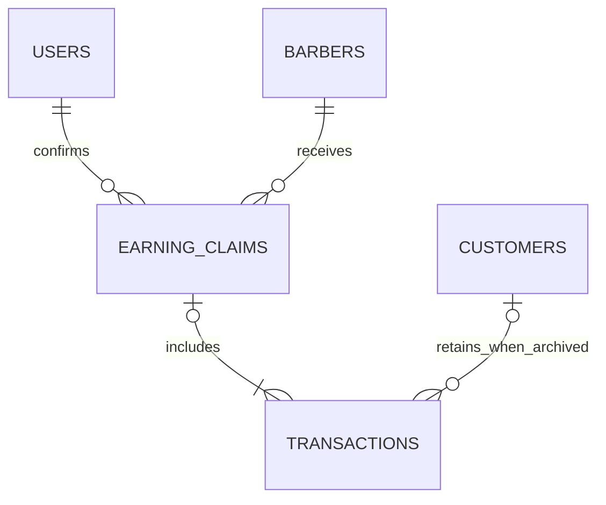

# Implementation and installation handoff

## Scope and delivery

This is an incremental update of the supplied Laravel repository. No framework replacement, dependency addition, production database access, GitHub push, or change to an already-existing migration was made. Source and a patch are supplied separately; apply to a backed-up working copy first. Generated local QA users/databases, `.env`, application keys, vendor dependencies, and test databases are not part of the delivered source.

Base repository commit: `46716ac52c567eb135f8aa57680cf1625f637fbb`. The patch applies to that commit; use the complete ZIP if your local copy has diverged. Do not overwrite an existing `.env` or application key. The full ZIP includes the verified production frontend build; the patch includes source changes, so run `npm ci --ignore-scripts && npm run build` after applying it. To check/apply a patch on the matching clean base: `git apply --check Cris-Barber-Shop-2026-10-20.patch`, then `git apply Cris-Barber-Shop-2026-10-20.patch`.

## 1. Changes by requirement

| Requirement | Delivered behavior |
| --- | --- |
| Barber creation | Separate First Name / Last Name; names are whitespace-normalized, `users.name` is composed from them. Login stems are lowercased, transliterated to ASCII, stripped of non-alphanumerics, and joined with a dot. Names are capped to 24 characters per login stem segment; blank ASCII segments fall back to `barber`/`staff`. Existing collisions append 2, 3, etc. Live read-only preview is advisory; the server assigns the unique address under a DB unique constraint with conflict retries. Submitted email is never trusted. |
| Modal forms | Barber create/edit/reset-password, customer create/edit, attendance corrections, and earnings confirmations use shared Alpine/native-dialog modals. The list stays the main view. Invalid modal forms reopen with field errors, old nonsecret inputs, and no password retention. Save buttons disable immediately; success/error feedback and confirmations are shared. Complex inventory/service configuration remains a dedicated editor. |
| Earnings claims | An owner confirms cash handover for an exact, reviewed transaction set. The ledger records the barber, amount, actual service-date range, transaction count, owner, confirmation timestamp, and retry token. Transactions link to one claim. Claiming does not change sales, shares, payments, or stock. Barber dashboards show Today, Unclaimed Balance, carried-over portion, Claimed Total, lifetime Total Earnings, and recent claims. Transactions and reports show current claim status/date. |
| Attendance | Clock-in/out use server time and a locked barber row plus unique barber/date key. Buttons reflect today's record and disable immediately after submission. Admin date roster includes every barber, including missing attendance, with present/absent/on-leave summaries and correction dialogs. Clocked In/Out are derived from times; Late/Absent/On Leave are recorded statuses. |
| Remove History | `/history`, its named route, navigation, and special controller behavior are removed. Transactions retains date/status/service/payment/search filters and pagination, adds earnings-status filtering, and always scopes barbers to their own records. Obsolete route expectations were replaced by Transactions coverage plus a regression asserting History is 404. |
| Inventory search | Bound partial, case-insensitive matching with full product names. Debounced 350ms live search preserves input focus, query/filter state, pagination, summary cards, and low-stock warnings. Stale requests are aborted/ignored; Filter remains a non-live fallback. |
| MySQL | MySQL defaults and XAMPP `.env.example`; MySQL/MariaDB-compatible additive migrations; isolated MySQL test config and a MySQL 8 CI job. Conditional stock updates and existing transaction/row locks remain in place. Safe optional SQLite import command is included. |
| Customer Recycle Bin | Owner-only archive list, deletion timestamp, transaction count including soft-deleted transactions, restore confirmation, and protected permanent deletion. Archived customers remain linked through `withTrashed()` and display `(archived)` in Transactions/details/reports. Checkout locks/rechecks an active customer before inserting a sale. |
| UI/UX | Shared forest/ivory design tokens, consistent typography/spacing/buttons/cards, responsive sidebar and top bar with identity/role/logout, redesigned split login, show/hide password, working forgot-password routes, logout confirmation/success message, badges, sticky table headers, scrollable tables, field errors, loading states, toasts, empty states, PHP amounts, and Asia/Manila times. Keyboard dialogs, focus states, mobile navigation focus containment, reduced motion, and a skip link are included. |

### Earnings definitions and payout safety

- **Today’s Earnings**: own completed, verified transactions whose `transaction_date` is today in Asia/Manila, whether already claimed or not.
- **Unclaimed Balance**: all own completed, verified earnings without `claim_id`, including today and earlier days. The card also shows the earlier-day carried portion.
- **Claimed Total**: own eligible transaction shares already linked to a claim.
- **Lifetime Total Earnings**: all own eligible shares, claimed plus unclaimed.
- Service dates continue to use existing `transaction_date`; this update does not restamp old sales when payment is verified or when cash is paid out.
- Confirmation re-queries eligible rows under `lockForUpdate()`, serializes same-barber payouts with a barber-row lock, compares IDs/shares against the reviewed fingerprint and exact amount, then writes one ledger row and transaction links in one DB transaction.
- Same token + same payout is idempotent; a reused token for another barber/set is rejected. A new token cannot claim already-claimed rows. A changed transaction set or amount requires fresh review. Unique token and foreign keys provide additional DB protection.
- No nightly reset or scheduled job is required. No payroll tax/deduction, payment gateway, split change, or retroactive repricing was introduced.

## 2. Database/data dictionary changes

### New migration: `2026_10_20_190710_create_earning_claims_and_link_transactions.php`

**New table: `earning_claims`**

| Column | Type | Constraint / meaning |
| --- | --- | --- |
| `id` | UUID | Primary key |
| `barber_id` | UUID | FK → `barbers.id`, restrict delete |
| `confirmed_by` | unsigned BIGINT | FK → `users.id`, restrict delete; owner who handed over cash |
| `amount` | DECIMAL(10,2) | Exact sum of linked barber shares |
| `period_start` | DATE | Earliest linked service date |
| `period_end` | DATE | Latest linked service date |
| `transaction_count` | unsigned INTEGER | Count of included transactions |
| `confirmed_at` | TIMESTAMP | Server confirmation time; app uses Asia/Manila |
| `claim_token` | UUID | Unique idempotency token |
| `fingerprint` | VARCHAR(64) | SHA-256 of the reviewed ordered IDs/shares |
| `created_at`, `updated_at` | TIMESTAMP, nullable | Laravel timestamps |

Index: `(barber_id, confirmed_at)`.

**Existing table: `transactions`**

- Added nullable UUID `claim_id`, FK → `earning_claims.id`, restrict delete.
- Added composite index `(barber_id, claim_id, status)` named `transactions_unclaimed_index`.
- Existing rows start with `claim_id = NULL`; no historical payout is invented. If earnings were already paid outside this system, reconcile the opening unclaimed balance with the owner before operational use.
- No duplicate `claimed_at` column: `transactions.claim_id → earning_claims.confirmed_at` is the authoritative claim timestamp.

### New migration: `2026_10_20_190711_normalize_payment_money_precision.php`

**Existing table: `payments`**

- `cash_received`: nullable DECIMAL(12,2) → nullable **DECIMAL(10,2)**.
- `change_amount`: nullable DECIMAL(12,2) → nullable **DECIMAL(10,2)**.
- Preflight blocks negative or oversized existing values before any ALTER; it never truncates them. New checkout tender is bounded to ₱99,999,999.99, matching the storage rule.
- All other existing monetary fields retain DECIMAL(10,2). Whole-quantity columns remain integers from the pre-existing precision migration.

Both new migrations are intentionally forward-only; restoring a verified backup is the recovery method. Earlier forward-only migrations already behave this way. No old migration was changed.

### Existing columns reused, not added

- `barbers.first_name`, `barbers.last_name`, `users.name`, `users.email`.
- `customers.deleted_at` and `transactions.deleted_at`.
- `attendance.barber_id`, `date`, `time_in`, `time_out`, `status`, existing unique `(barber_id,date)`.
- `transactions.status`, `transaction_date`, `completed_at`, `inventory_deducted_at`, `checkout_token`.
- `payments.verification_status` and existing unique payment/reference constraints.

### ERD addition



A transaction may have zero or one claim; an actual recorded claim includes one or more transactions. Existing customer IDs and transaction relationships are preserved through archive and restore.

### Use-case diagram updates

**Remove** the standalone owner/barber “View History” use case. Both use “View/Search/Filter Transactions”; barber visibility remains own-only.

**Owner additions**: Review Unclaimed Earnings → Confirm Cash Handover → Record Earnings Claim; View Payout Ledger; View Customer Recycle Bin → Restore Customer; Permanently Delete Empty Archived Customer (guard: no active or archived transactions); View Daily All-Barber Roster → Correct Attendance.

**Barber additions**: View Unclaimed/Carried/Claimed Earnings; View Claim Status and Date. Barber has no payout-confirmation permission and no customer recovery access.

## 3. Exact XAMPP / phpMyAdmin installation steps

### A. Brand-new database

1. Confirm CLI and web PHP are **8.3 or newer** with the required extensions. Many older XAMPP distributions use PHP 8.2 and will not run Laravel 13. Do not ignore Composer platform requirements.
2. Start XAMPP MySQL. Open phpMyAdmin, choose **Databases**, enter `cris_barber_shop`, select `utf8mb4_unicode_ci`, click **Create**. SQL equivalent:

```sql
CREATE DATABASE cris_barber_shop CHARACTER SET utf8mb4 COLLATE utf8mb4_unicode_ci;
```

3. Open a terminal in a **new extracted project copy**:

```sh
composer install --no-interaction --prefer-dist
```

4. Copy `.env.example` to `.env` (`cp .env.example .env` on Linux/macOS; `Copy-Item .env.example .env` in PowerShell), and verify:

```dotenv
APP_NAME="Cris Barber Shop"
APP_URL=http://localhost:8000
APP_TIMEZONE=Asia/Manila
DB_CONNECTION=mysql
DB_HOST=127.0.0.1
DB_PORT=3306
DB_DATABASE=cris_barber_shop
DB_USERNAME=root
DB_PASSWORD=
```

Remove any overriding `DB_URL`. Set your real local password if XAMPP root is not passwordless.

5. For this **new instance only**:

```sh
php artisan key:generate
php artisan config:clear
php artisan migrate --seed
php artisan shop:admin owner@crisbarber.com --name="Shop Owner"
npm ci --ignore-scripts
npm run build
php artisan serve --host=127.0.0.1 --port=8000
```

The admin command prompts privately for a password of at least 12 characters. Default seeding adds services, not a default admin password or real stock. Do not load `InventorySampleSeeder` into real inventory. phpMyAdmin shows the database/tables after migration. If using Apache instead of Artisan, configure its document root to Laravel's **`public` directory**, never the project root.

### B. Existing MySQL shop installation

1. Back up/restore-test the database, code, `.env`/existing `APP_KEY`, uploads, and storage. Apply to a separate staging copy first.
2. Preserve the existing `.env` and `APP_KEY`; do not copy the example over it. Point staging at a separate database copy, not production.
3. Stop writes during migration. Then:

```sh
composer install --no-interaction --prefer-dist
php artisan config:clear
php artisan shop:audit-data
php artisan migrate:status
php artisan migrate --pretend
php artisan migrate
php artisan shop:audit-data
npm ci --ignore-scripts
npm run build
php artisan view:cache
```

Stop if audit/migration fails. Existing fractional/negative quantities, duplicate references/receipts, or oversized tender require owner reconciliation, not silent rounding/deletion. Do not rerun seeders blindly on an existing shop installation. Do not use `migrate:fresh`, `db:wipe`, or rollback.

### C. Move existing SQLite business data to MySQL

This is a separate path: **do not run `--seed` before importing**, because the destination business tables must be empty.

1. Stop all app writes and background workers. Take a consistent SQLite backup using SQLite-aware backup tooling (or a clean shutdown/checkpoint of any WAL state), not an arbitrary live copy of just the `.sqlite` file. Keep the original, code, uploads, and existing `.env`/`APP_KEY` protected. Work on a backup copy in staging first.
2. Create a new **empty** destination database in phpMyAdmin. Keep the old SQLite installation and backup intact until reconciliation is complete.
3. In a separate updated project copy, retain the old `APP_KEY`, update only DB settings to the new MySQL database, clear config, and create the schema **without seed data**:

```sh
php artisan config:clear
php artisan migrate
php artisan shop:import-sqlite "/absolute/path/to/database-backup.sqlite" --dry-run
php artisan shop:import-sqlite "/absolute/path/to/database-backup.sqlite"
php artisan shop:audit-data
```

Windows accepts a quoted absolute path, for example `"C:\backups\cris.sqlite"`. Enable PDO SQLite and PDO MySQL in the CLI PHP used by this command.

4. The import preserves IDs, password hashes, exact monetary snapshots, stock balances, timestamps, archived customer/transaction flags, pivots, payment verification, inventory movements, attendance and existing claims if present. Missing new optional claim data stays empty/unclaimed. It does not copy migrations, sessions, cache, jobs, reset tokens, uploads, or logs. Keep uploaded files separately. It refuses nonempty destination business tables and rejects invalid quantity/money/split data. Inserts run with destination foreign keys/unique keys enabled in one transaction; failure rolls back imported business rows. The source is only read and is not modified.
5. `--dry-run` validates source values/schema presence and destination emptiness; relational and unique-key validity is checked during the transactional import. It is not a full rehearsal of insert constraints.
6. Compare source and destination table counts, revenue and share totals, payment verification counts, stock/movement balances, attendance, several old customer records, and archive/restore behavior. The command checks imported row counts; it does **not** replace owner reconciliation or certify arbitrary historical data. Do not recalculate splits or deduct stock during transfer. A failed import leaves the MySQL schema in place but commits no imported business rows.
7. Once reconciled, build assets and test login/reports on MySQL. Only then switch the real application DB settings during a controlled maintenance window. Do not import into production automatically. Keep the old backup for recovery.

## 4. Tests and verification

Environment used: PHP 8.4.24; Laravel 13.32.0; Node 24; MariaDB 10.11.18; SQLite; headless Chromium for UI checks.

- Original baseline: **151 tests passed**.
- Updated default SQLite suite: **166 passed, 2 skipped**, 1,222 assertions. The skips are SQLite-to-MySQL import checks.
- Updated MySQL-connection/MariaDB suite: **164 passed, 4 skipped**, 1,214 assertions. The skips explicitly exercise SQLite trigger/affinity-based synthetic legacy data. HTTP integer validation, financial/stock regressions, claims, customer recovery, and import tests run on MariaDB.
- Fresh complete migration chain and default seeder succeeded on MariaDB.
- `composer validate --strict`, `npm run build`, Blade compilation, and Pint passed.
- New regression tests cover generated email normalization/collisions/server authority, payout eligibility/carryover/idempotency/stale review/role boundaries, clock protection and roster completeness, partial case-insensitive search, archived customer names/reports/claims/restore/protected deletion, removed History routing/privacy, local-login reset guidance, schema precision, and safe SQLite transfer.

Run locally:

```sh
php artisan config:clear
php artisan test --compact
# Create cris_barber_shop_testing in phpMyAdmin first; NEVER use the live database:
php vendor/phpunit/phpunit/phpunit -c phpunit.mysql.xml
npm run build
php artisan view:cache
```

The base test class refuses any destination other than in-memory SQLite or local `127.0.0.1` / `cris_barber_shop_testing` with no DB URL override. MySQL tests use `RefreshDatabase` and reset that test database. Supply credentials via the shell if not root/blank. Example PowerShell:

```powershell
$env:DB_USERNAME = "root"
$env:DB_PASSWORD = "your-local-test-password"
php vendor/phpunit/phpunit/phpunit -c phpunit.mysql.xml
Remove-Item Env:DB_PASSWORD
```

GitHub Actions runs the suites against SQLite and **Oracle MySQL 8**. The workflow was added but not executed remotely in this session. Local verification used MariaDB, not an Oracle MySQL server. Windows/XAMPP execution must still be checked on your machine.

### Final browser checks

Local Chromium checks covered owner pages at 1440px and 390px widths, generated-email collision preview, partial live product search, invalid-form modal reopening, responsive navigation, a real POS checkout followed by owner-confirmed payout, logout confirmation, and barber attendance button state. The checked pages had no page-level horizontal overflow and no captured JavaScript errors. Wide tables intentionally scroll within their containers. This is functional/visual QA, not a formal accessibility audit.

The MySQL command above invokes PHPUnit directly because passing a second configuration through this Laravel Artisan test wrapper triggers a duplicate-configuration warning. The direct command exits successfully.

## 5. Assumptions and limitations

- Payout means the owner has handed the barber cash. There is no self-service withdrawal, bank transfer, payout reversal, partial individual-transaction payout, or approval queue. Smaller payouts can be selected by service-date range. No claim deletion/edit endpoint is exposed. A mistaken handover needs an explicit future accounting adjustment workflow, not record deletion.
- Existing historical payouts are unknown; all old eligible rows begin unclaimed. Reconcile opening liability before recording real payouts.
- No work-shift start time was supplied, so lateness is owner-assigned rather than guessed. Missing past records appear Absent; current/future missing records appear Not Yet Clocked In. Where there is no daily record, On Leave reflects the barber's current leave setting, not a fabricated historical leave schedule; owners should record/correct historical leave explicitly.
- No hours/earnings relationship was changed. Attendance does not create or reduce transaction earnings.
- Generated `.local` email addresses are login identifiers, not mailboxes. Forgot Password explains owner-assisted reset for them. Existing real-email accounts retain Laravel email-reset capability, but actual delivery requires configured SMTP; live delivery was not tested.
- Complex inventory and service editors remain dedicated screens. Small account/customer/attendance/payout actions are dialogs; no new frontend dependency was added.
- The optional recycle bin for archived **non-completed transactions** was considered but not added. Restoring an active queue record needs explicit conflict handling for a barber's current queue/service assignment. Existing soft-deleted transaction audit data remains in the DB; it is not counted as active sales. Customer permanent-delete protection counts those archived records too.
- Print/Save as PDF is the existing browser-based PDF workflow, not a server-generated binary PDF. CSV export remains a streamed response. Large print/CSV reports currently load detail rows and should be load-tested for the shop's actual volume.
- Local tests verify repeated/stale payout requests, transaction rollback and uniqueness. Pessimistic locks protect concurrent requests, but no multi-process stress/load test or production security certification was performed.
- The source can be downloaded and applied locally. Nothing was pushed to the GitHub repository, and no actual shop data was moved.
